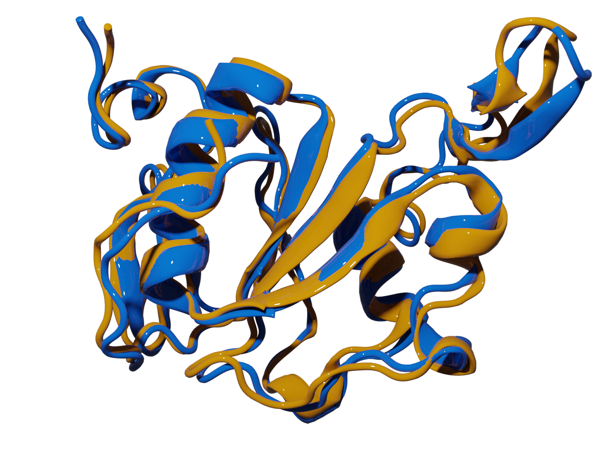

<p align="center">
  <picture>
    <source media="(prefers-color-scheme: dark)" srcset="https://raw.githubusercontent.com/mqcomplab/MDANCE/main/docs/_static/mdance-dark.png">
    
  </picture>
</p>

<h3 align="center">Molecular Dynamics Analysis with <i>N</i>-ary Clustering Ensembles</h3>

<p align="center">
  Cluster millions of MD frames in minutes, with the same result on every run.
</p>

<p align="center">
  <a href="https://pypi.org/project/mdance/"></a>
  <a href="https://pypi.org/project/mdance/"></a>
  <a href="https://mdance.readthedocs.io/en/latest/"></a>
  <a href="https://github.com/mqcomplab/MDANCE/blob/main/LICENSE"></a>
</p>

<p align="center">
  <a href="#installation">Installation</a> •
  <a href="#quick-start">Quick start</a> •
  <a href="#algorithms">Algorithms</a> •
  <a href="https://mdance.readthedocs.io/en/latest/">Documentation</a> •
  <a href="#citing-mdance">Citing</a>
</p>

## Why MDANCE

Most clustering tools compare frames two at a time. That breaks down on modern simulations:

- **Quadratic cost.** Comparing every frame with every other frame means doubling the trajectory quadruples the work.
- **Memory.** A full RMSD matrix for a million-frame trajectory takes terabytes before clustering even starts.
- **Poor initialization.** Random seeding gives suboptimal clusters, and different clusters on every run.
- **Hard follow-up questions.** Finding the dominant pathways, or the native structure, in a large ensemble is difficult.

MDANCE is built on *n*-ary (extended) similarity, which compares all frames at once and finds high- and low-density regions in linear time. Its algorithms:

- scale linearly with the number of frames, from O(*N*²) to O(*N*), without pairwise distance matrices;
- use deterministic seeding, so the same input gives the same clusters;
- are designed for structural biology and validated against experimental structures.

Researchers use MDANCE to find biologically relevant conformations for drug discovery, study mechanisms through pathway analysis, validate models against experimental structures, and analyze very large simulation datasets.

## Installation

```bash
pip install mdance
```

MDANCE requires Python 3.10 or newer. To install from source:

```bash
git clone https://github.com/mqcomplab/MDANCE.git
cd MDANCE
pip install -e .
```

## Quick start

New to NANI? See it in action first: [Learn NANI in 60 seconds](https://mdance.readthedocs.io/en/latest/nani-in-60-seconds.html) (interactive).

Cluster the example trajectory included with MDANCE (6,001 frames of 50 atoms) with NANI seeding and *k*-means:

```python
import numpy as np
from sklearn.cluster import KMeans
from mdance import data
from mdance.cluster.nani import KmeansNANI

X = np.load(data.sim_traj_numpy)

# Deterministic NANI seeds
nani = KmeansNANI(data=X, n_clusters=6, metric='MSD', N_atoms=50,
                  init_type='strat_reduced', percentage=10)
centroids = nani.initiate_kmeans()

# k-means from the NANI seeds gives the same labels every run
labels = KMeans(n_clusters=6, init=centroids, n_init=1).fit(X).labels_
```

To use your own trajectory, convert it to a NumPy array first ([preprocessing tutorial](https://github.com/mqcomplab/MDANCE/blob/main/scripts/inputs/preprocessing.ipynb)). Every algorithm also has ready-to-run scripts in [`scripts/`](https://github.com/mqcomplab/MDANCE/tree/main/scripts).

## Algorithms

| Algorithm | What it does | Best for | Tutorial | Paper |
|:---:|---|---|---|---|
| <br>**NANI** | Deterministic *k*-means seeding that finds metastable states | Simple analysis | [Tutorial](https://mdance.readthedocs.io/en/latest/tutorials/nani.html) | [JCTC 2024](https://doi.org/10.1021/acs.jctc.4c00308), [JCIM 2026](https://doi.org/10.1021/acs.jcim.5c02741) |
| <br>**HELM** | Hierarchical clustering at *k*-means cost | High-resolution hierarchies | [Tutorial](https://mdance.readthedocs.io/en/latest/tutorials/helm.html) | [JCIM 2025](https://doi.org/10.1021/acs.jcim.5c00539) |
| <br>**DIVINE** | Top-down divisive clustering, every resolution in one pass | Fast hierarchies | [Tutorial](https://github.com/mqcomplab/MDANCE/blob/main/tutorials/divine.md) | [JCIM 2026](https://doi.org/10.1021/acs.jcim.5c02740) |
| <br>**mdBIRCH** | Online clustering with an RMSD-calibrated merge test | Very large or streaming trajectories | [Tutorial](https://github.com/mqcomplab/MDANCE/blob/main/tutorials/mdbirch.md) | [JCTC 2026](https://doi.org/10.1021/acs.jctc.6c00221) |
| <br>**SHINE** | Finds the dominant pathways in enhanced-sampling data | Pathway exploration | [Tutorial](https://github.com/mqcomplab/MDANCE/blob/main/tutorials/shine.md) | [JCIM 2025](https://doi.org/10.1021/acs.jcim.5c00240) |
| <br>**PRISM** | Compares pathways by their structural medoids | Multi-pathway comparison | [Tutorial](https://github.com/mqcomplab/MDANCE/blob/main/tutorials/prism.md) | [Digital Discovery 2026](https://doi.org/10.1039/d6dd00288a) |
| <br>**eQual** | Radial threshold clustering in linear time | Clusters of a set radius | [Tutorial](https://mdance.readthedocs.io/en/latest/tutorials/equal.html) | [JCIM 2025](https://doi.org/10.1021/acs.jcim.4c02341) |
| <br>**PRIME** | Retrieves the native structure from a clustered ensemble | Structure selection | [Tutorial](https://mdance.readthedocs.io/en/latest/tutorials/prime.html) | [JCTC 2024](https://doi.org/10.1021/acs.jctc.4c00362) |

<details>
<summary><b>More about each algorithm</b></summary>

#### NANI: *k*-means initialization
- Solves the seed selection problem of *k*-means: picks diverse initial centroids from high-density regions using *n*-ary comparisons.
- Gives compact, well-separated clusters that find metastable states, with consistent populations across replicates.
- Clusters 1.5 million HP35 frames in about 40 minutes.

#### HELM: hybrid hierarchical clustering
- Combines *k*-means efficiency with hierarchical flexibility using *n*-ary difference functions.
- Keeps the cost of *k*-means while allowing any partition: the hierarchy is built without a pairwise distance matrix, so any number of clusters can be taken from one run.
- Clusters 1.5 million frames in about 34 minutes. Classic hierarchical clustering already needs 29 hours for 75,000 frames.

#### DIVINE: divisive hierarchical clustering
- Splits clusters top-down, choosing the next cluster to split by a weighted variance criterion.
- Uses NANI anchors, so every split is deterministic, and never builds a pairwise distance matrix.
- Explores every resolution in a single pass.
- Matches or exceeds bisecting *k*-means quality in less time.

#### mdBIRCH: online clustering
- Adapts the BIRCH CF-tree to MD data and processes frames as they arrive.
- The merge test is calibrated to RMSD, so its threshold has a physical meaning.
- Avoids pairwise distance matrices and scales near-linearly with the number of frames: hundreds of thousands of frames on a single CPU core in seconds.
- Two protocols: runs anchored to a chosen RMSD, and a blind sweep over thresholds.

#### SHINE: pathway clustering
- Groups pathways from multiple simulations, such as enhanced-sampling runs, and picks the most representative pathway in each group.
- Combines *n*-ary similarity with tools from cheminformatics to reveal the dominant transformation mechanisms.
- Costs less than Fréchet-distance approaches.
- Applied to alanine dipeptide and adenylate kinase.

#### PRISM: pathway representation
- Summarizes each pathway by a compact set of structural medoids.
- Clusters pathways by weighted average Hausdorff distance with hierarchical clustering.
- Offers three ways to build the medoids: shared global medoids, per-pathway medoids, or a two-stage refinement.
- Designed for comparing and classifying many pathways, for example from enhanced sampling.

#### eQual: radial threshold clustering
- Turns O(*N*²) radial threshold clustering into an O(*N*) algorithm with new seed selection and tie-breaking.
- Selects seeds with *k*-means++ and breaks ties with extended similarity indices, for deterministic results.
- Uses no memory-intensive pairwise RMSD matrix.
- Gives compact, well-separated clusters of the same quality as the original method.

#### PRIME: native structure prediction
- Uses *n*-ary similarity across clusters to pick the most native-like frame of an ensemble.
- Mapped all structural motifs in benchmark studies, and consistently identified native structures within 2 Å RMSD of experimental data.

<p align="center">
  <br>
  <i>2k2e: structure from PRIME (yellow) superposed on the experimental native structure (blue).</i>
</p>

</details>

## Citing MDANCE

If you use MDANCE, please cite the paper of each algorithm you use (linked in the table above). BibTeX entries for all papers are in [CITATION.bib](https://github.com/mqcomplab/MDANCE/blob/main/CITATION.bib).

## Contributing

We welcome collaborations and contributions, whether you are a computational biologist with new analysis needs, a method developer who wants to extend the framework, or a structural biologist with a challenging dataset.

- Open an [issue](https://github.com/mqcomplab/MDANCE/issues) for bug reports or feature requests.
- Submit a pull request with improvements.
- Get in touch to discuss a research collaboration.

## Funding

This research was supported by the National Institute of General Medical Sciences of the National Institutes of Health under award number R35GM150620.

## License

MDANCE is released under the [MIT License](https://github.com/mqcomplab/MDANCE/blob/main/LICENSE).
